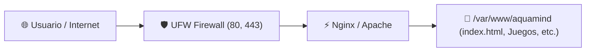
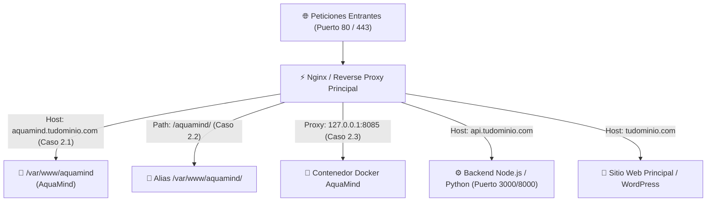

# 🚀 Guía de Despliegue e Implementación en Servidor Ubuntu
## AquaMind - Plataforma Educativa para el Cuidado del Agua

Esta guía detalla paso a paso cómo desplegar y poner en producción la plataforma web **AquaMind** en un servidor con sistema operativo **Ubuntu Linux** (compatible con Ubuntu 20.04 LTS, 22.04 LTS y 24.04 LTS).

Se contemplan los dos escenarios principales de infraestructura:
1. **Escenario 1: Servicio Único (Servidor Dedicado):** AquaMind es el único servicio web del servidor y atiende directamente en los puertos estándar HTTP (`80`) y HTTPS (`443`).
2. **Escenario 2: Servidor Compartido (Multi-Servicio):** El servidor ya aloja otras aplicaciones (como APIs en Node.js/Python, bases de datos PostgreSQL/MySQL, contenedores Docker o sitios WordPress/PHP). AquaMind se integra sin generar conflictos mediante subdominios, subrutas o proxies inversos.

---

## 📑 Tabla de Contenidos

1. [Arquitectura y Características del Proyecto](#-arquitectura-y-características-del-proyecto)
2. [Requisitos Previos en Ubuntu](#-requisitos-previos-en-ubuntu)
3. [Preparación de los Archivos en el Servidor](#-preparación-de-los-archivos-en-el-servidor)
4. [Escenario 1: Despliegue como Servicio Único (Servidor Dedicado)](#-escenario-1-despliegue-como-servicio-único)
   - [Opción 1.1: Nginx Nativo (Recomendada)](#opción-11-nginx-nativo-recomendada)
   - [Opción 1.2: Apache2](#opción-12-apache2)
   - [Opción 1.3: Docker Standalone](#opción-13-docker-standalone)
5. [Escenario 2: Despliegue en Servidor Compartido (Multi-Servicio)](#-escenario-2-despliegue-en-servidor-compartido)
   - [Caso 2.1: Mediante Subdominio / Virtual Host (Recomendado)](#caso-21-mediante-subdominio--virtual-host-recomendado)
   - [Caso 2.2: Mediante Subruta en un Sitio Existente (`/aquamind/`)](#caso-22-mediante-subruta-en-un-sitio-existente-aquamind)
   - [Caso 2.3: Contenedor Docker + Reverse Proxy del Sistema](#caso-23-contenedor-docker--reverse-proxy-del-sistema)
6. [Seguridad SSL/TLS (HTTPS) con Let's Encrypt](#-seguridad-ssltls-https-con-lets-encrypt)
7. [Script de Actualización Continua (Zero-Downtime)](#-script-de-actualización-continua-zero-downtime)
8. [Resolución de Problemas Frecuentes (Troubleshooting)](#-resolución-de-problemas-frecuentes-troubleshooting)

---

## 🧠 Arquitectura y Características del Proyecto

AquaMind es una **Single-Page / Multi-Module Static Web Application** desarrollada con estándares web nativos (HTML5 semántico, CSS3 moderno y Vanilla JavaScript ES6+).

- **Sin dependencias backend:** No requiere runtime pesado (Node.js, Python, Ruby, PHP) para renderizar o procesar datos.
- **Consumo de recursos:** Prácticamente nulo en el servidor (menos de 20 MB de memoria RAM asignada al proceso web).
- **Rutas y Assets Relativos:** Todas las llamadas a estilos, módulos interactivos (`Juegos/Atrapar/`, `Juegos/Quiz/`, `Proyecto Consejos/`) y documentos descargables (`Anexos/Guia_Educativa.pdf`) están configuradas con enlaces relativos, lo que garantiza portabilidad absoluta tanto en la raíz de un dominio como dentro de subdirectorios.

---

## 📋 Requisitos Previos en Ubuntu

Conéctate a tu servidor Ubuntu por SSH como usuario con privilegios `sudo`:

```bash
ssh usuario@ip_del_servidor
```

### 1. Actualizar repositorios y paquetes del sistema
```bash
sudo apt update && sudo apt upgrade -y
```

### 2. Instalar herramientas esenciales
```bash
sudo apt install -y git curl ufw unzip
```

---

## 📁 Preparación de los Archivos en el Servidor

La ubicación estándar en Ubuntu para servir aplicaciones web es `/var/www/`.

### 1. Clonar el repositorio
```bash
sudo mkdir -p /var/www/aquamind
sudo git clone https://github.com/Kscf27/Proyecto_ing1_cuidado_del_agua.git /var/www/aquamind
```

> [!NOTE]
> Si deseas clonar en una ruta alternativa como `/opt/aquamind`, simplemente adapta las rutas en los archivos de configuración descritos a continuación.

### 2. Ajustar permisos y propiedad de archivos
El servidor web (`nginx` o `apache2`) se ejecuta bajo el usuario del sistema `www-data`. Otorgamos la titularidad y los permisos de lectura adecuados:

```bash
# Asignar propietario www-data
sudo chown -R www-data:www-data /var/www/aquamind

# Permisos de directorios (755: lectura y ejecución)
sudo find /var/www/aquamind -type d -exec chmod 755 {} \;

# Permisos de archivos (644: lectura)
sudo find /var/www/aquamind -type f -exec chmod 644 {} \;
```

> [!IMPORTANT]
> **Sensibilidad a mayúsculas y espacios (Linux Case Sensitivity):**
> En sistemas Linux (ext4), los nombres de archivo y carpetas son estrictamente sensibles a mayúsculas y minúsculas (`Juegos/`, `Proyecto Consejos/`, `Imagenes/`). No renombres carpetas manualmente a menos que sincronices las referencias internas del código.

---

## 🏛️ Escenario 1: Despliegue como Servicio Único

Aplica cuando el servidor está dedicado únicamente a esta plataforma y escucha en el puerto `80` (HTTP) y `443` (HTTPS).



### Opción 1.1: Nginx Nativo (Recomendada)

Nginx es el servidor web estático más rápido, ligero y eficiente para Ubuntu.

#### 1. Instalar Nginx
```bash
sudo apt install -y nginx
sudo systemctl enable nginx
sudo systemctl start nginx
```

#### 2. Crear la configuración del sitio
Crea el archivo `/etc/nginx/sites-available/aquamind.conf`:

```bash
sudo nano /etc/nginx/sites-available/aquamind.conf
```

Pega la siguiente configuración de alto rendimiento con soporte para Gzip, caché de assets y cabeceras de seguridad:

```nginx
server {
    listen 80 default_server;
    listen [::]:80 default_server;

    # Si cuentas con un dominio, cámbialo aquí. Si no, usa '_' o tu IP pública.
    server_name _;

    root /var/www/aquamind;
    index index.html;

    # Logs específicos del proyecto
    access_log /var/log/nginx/aquamind_access.log;
    error_log /var/log/nginx/aquamind_error.log;

    # Charset predeterminado
    charset utf-8;

    # Compresión Gzip para acelerar la carga en conexiones móviles
    gzip on;
    gzip_vary on;
    gzip_proxied any;
    gzip_comp_level 6;
    gzip_types text/plain text/css text/xml application/json application/javascript application/xml+rss application/atom+xml image/svg+xml;

    # Cabeceras de seguridad HTTP
    add_header X-Content-Type-Options "nosniff" always;
    add_header X-XSS-Protection "1; mode=block" always;
    add_header Referrer-Policy "no-referrer-when-downgrade" always;

    # Enrutamiento principal
    location / {
        try_files $uri $uri/ =404;
    }

    # Caché agresiva para imágenes, estilos, scripts y fuentes
    location ~* \.(jpg|jpeg|png|gif|ico|svg|css|js|woff|woff2|ttf|eot)$ {
        expires 30d;
        add_header Cache-Control "public, no-transform";
        access_log off;
    }

    # Caché para documentos didácticos (PDF)
    location ~* \.pdf$ {
        expires 7d;
        add_header Cache-Control "public";
    }

    # Denegar acceso a archivos ocultos (ej. .git)
    location ~ /\. {
        deny all;
        access_log off;
        log_not_found off;
    }
}
```

#### 3. Habilitar el sitio y desactivar el default
```bash
# Deshabilitar el sitio por defecto de Nginx
sudo rm -f /etc/nginx/sites-enabled/default

# Crear enlace simbólico para activar AquaMind
sudo ln -s /etc/nginx/sites-available/aquamind.conf /etc/nginx/sites-enabled/

# Validar sintaxis de configuración
sudo nginx -t
```
Si el resultado es `syntax is ok` y `test is successful`:
```bash
sudo systemctl reload nginx
```

#### 4. Configurar el cortafuegos (UFW)
```bash
sudo ufw allow 'Nginx Full'
sudo ufw allow OpenSSH
sudo ufw enable
```

---

### Opción 1.2: Apache2

Si tu infraestructura utiliza Apache en lugar de Nginx:

#### 1. Instalar Apache y módulos recomendados
```bash
sudo apt install -y apache2
sudo a2enmod rewrite headers deflate expires
sudo systemctl enable apache2
sudo systemctl start apache2
```

#### 2. Crear el VirtualHost
Crea el archivo `/etc/apache2/sites-available/aquamind.conf`:

```bash
sudo nano /etc/apache2/sites-available/aquamind.conf
```

Agrega la configuración:

```apache
<VirtualHost *:80>
    ServerAdmin webmaster@localhost
    DocumentRoot /var/www/aquamind

    # Logs del sitio
    ErrorLog ${APACHE_LOG_DIR}/aquamind_error.log
    CustomLog ${APACHE_LOG_DIR}/aquamind_access.log combined

    <Directory /var/www/aquamind>
        Options -Indexes +FollowSymLinks
        AllowOverride All
        Require all granted
    </Directory>

    # Compresión de contenido
    AddOutputFilterByType DEFLATE text/html text/plain text/xml text/css application/javascript application/json image/svg+xml

    # Cabeceras de seguridad
    Header set X-Content-Type-Options "nosniff"
    Header set X-XSS-Protection "1; mode=block"

    # Caché de archivos estáticos
    <IfModule mod_expires.c>
        ExpiresActive On
        ExpiresByType image/jpg "access plus 1 month"
        ExpiresByType image/jpeg "access plus 1 month"
        ExpiresByType image/gif "access plus 1 month"
        ExpiresByType image/png "access plus 1 month"
        ExpiresByType image/svg+xml "access plus 1 month"
        ExpiresByType text/css "access plus 1 month"
        ExpiresByType application/javascript "access plus 1 month"
        ExpiresByType application/pdf "access plus 1 week"
    </IfModule>
</VirtualHost>
```

#### 3. Activar el sitio
```bash
sudo a2dissite 000-default.conf
sudo a2ensite aquamind.conf
sudo apache2ctl configtest
sudo systemctl reload apache2
```

---

### Opción 1.3: Docker Standalone

Para desplegar de forma encapsulada sin instalar servidores web directamente en el sistema operativo anfitrión:

#### 1. Instalar Docker y Docker Compose en Ubuntu
```bash
sudo apt install -y docker.io docker-compose-v2
sudo systemctl enable docker
sudo systemctl start docker
```

#### 2. Despliegue con Docker Compose
En el directorio raíz del proyecto (`/var/www/aquamind`):

Crea el archivo `docker-compose.yml`:
```yaml
services:
  aquamind:
    image: nginx:alpine
    container_name: aquamind-app
    restart: unless-stopped
    ports:
      - "80:80"
    volumes:
      - ./:/usr/share/nginx/html:ro
```

Inicia el contenedor en segundo plano:
```bash
cd /var/www/aquamind
sudo docker compose up -d
```

---

## 🔀 Escenario 2: Despliegue en Servidor Compartido

En este escenario, el servidor Ubuntu ya tiene activos otros servicios (por ejemplo, aplicaciones Node.js en el puerto 3000, Python FastAPI en el puerto 8000, un servidor MySQL, o sitios web corporativos).

AquaMind debe convivir en armonía sin monopolizar ni interrumpir las otras aplicaciones.



---

### Caso 2.1: Mediante Subdominio / Virtual Host (Recomendado)

Esta es la mejor práctica para servidores compartidos. Asignas un subdominio específico (ej. `aquamind.tudominio.com` o `agua.institucion.edu.co`) mientras los demás servicios continúan operando en sus respectivos dominios.

#### Configuración en Nginx existente:

Crea un archivo independiente para el subdominio:
```bash
sudo nano /etc/nginx/sites-available/aquamind-subdomain.conf
```

Contenido:
```nginx
server {
    listen 80;
    listen [::]:80;

    # Define exclusivamente el subdominio asignado
    server_name aquamind.tudominio.com;

    root /var/www/aquamind;
    index index.html;

    access_log /var/log/nginx/aquamind_sub_access.log;
    error_log /var/log/nginx/aquamind_sub_error.log;

    charset utf-8;

    gzip on;
    gzip_types text/plain text/css application/javascript application/json image/svg+xml;

    location / {
        try_files $uri $uri/ =404;
    }

    location ~* \.(jpg|jpeg|png|gif|ico|svg|css|js|pdf)$ {
        expires 30d;
        add_header Cache-Control "public";
    }
}
```

Habilita el sitio sin reiniciar el servidor (cero afectación a otros sitios):
```bash
sudo ln -s /etc/nginx/sites-available/aquamind-subdomain.conf /etc/nginx/sites-enabled/
sudo nginx -t
sudo systemctl reload nginx
```

---

### Caso 2.2: Mediante Subruta en un Sitio Existente (`/aquamind/`)

Si no dispones de un subdominio y deseas que la plataforma esté disponible como una subcarpeta del dominio principal (por ejemplo: `https://tudominio.com/aquamind/`):

Edita el bloque `server` del sitio principal existente en `/etc/nginx/sites-available/tu_sitio_principal.conf`:

```nginx
server {
    listen 80;
    server_name tudominio.com www.tudominio.com;

    # Tu aplicación principal (ej. proxy a Node.js, PHP, etc.)
    location / {
        proxy_pass http://127.0.0.1:3000;
        # ... demás directivas existentes ...
    }

    # ==========================================
    # AGREGAR AQUÍ LA SUBRUTA PARA AQUAMIND
    # ==========================================
    location /aquamind/ {
        alias /var/www/aquamind/;
        index index.html;
        try_files $uri $uri/ /aquamind/index.html;

        # Compresión
        gzip on;
        gzip_types text/plain text/css application/javascript application/json image/svg+xml;

        # Caché de estáticos dentro de la subruta
        location ~* ^/aquamind/(.+\.(jpg|jpeg|png|gif|ico|svg|css|js|pdf))$ {
            alias /var/www/aquamind/$1;
            expires 30d;
            add_header Cache-Control "public";
        }
    }
}
```

> [!IMPORTANT]
> **Atención a la barra diagonal (`/`) final:**
> Tanto en `location /aquamind/` como en `alias /var/www/aquamind/;`, la barra final es obligatoria para que Nginx traduzca correctamente los nombres de archivos relativos.

Verifica y recarga:
```bash
sudo nginx -t
sudo systemctl reload nginx
```

Ahora el sitio estará accesible en `http://tudominio.com/aquamind/`.

---

### Caso 2.3: Contenedor Docker + Reverse Proxy del Sistema

Si prefieres aislar completamente los archivos dentro de un contenedor Docker para no tocar las rutas de `/var/www` del servidor:

#### 1. Correr el contenedor en un puerto local privado
Elige un puerto no utilizado por tus otros servicios (por ejemplo, el `8085` solo visible en `127.0.0.1`):

```bash
cd /var/www/aquamind

sudo docker run -d \
  --name aquamind-service \
  --restart unless-stopped \
  -p 127.0.0.1:8085:80 \
  -v $(pwd):/usr/share/nginx/html:ro \
  nginx:alpine
```

> Con `-p 127.0.0.1:8085:80`, el puerto **no** queda expuesto a internet directamente, solo al Nginx anfitrión.

#### 2. Redirigir el tráfico desde Nginx del servidor host
En el archivo de configuración de Nginx (`/etc/nginx/sites-available/aquamind.conf`):

```nginx
server {
    listen 80;
    server_name aquamind.tudominio.com;

    location / {
        proxy_pass http://127.0.0.1:8085;
        proxy_set_header Host $host;
        proxy_set_header X-Real-IP $remote_addr;
        proxy_set_header X-Forwarded-For $proxy_add_x_forwarded_for;
        proxy_set_header X-Forwarded-Proto $scheme;
    }
}
```

Recarga Nginx:
```bash
sudo nginx -t
sudo systemctl reload nginx
```

---

## 🔒 Seguridad SSL/TLS (HTTPS) con Let's Encrypt

Para habilitar certificados SSL gratuitos, automáticos y con renovación programada:

### 1. Instalar Certbot
```bash
sudo apt install -y certbot python3-certbot-nginx
```
*(Si usas Apache: `sudo apt install -y certbot python3-certbot-apache`)*

### 2. Generar el certificado

#### Para Nginx:
```bash
sudo certbot --nginx -d tudominio.com -d aquamind.tudominio.com
```

Certbot modificará automáticamente la configuración de Nginx para redirigir todo el tráfico HTTP a HTTPS de forma segura.

### 3. Verificar la renovación automática
```bash
sudo certbot renew --dry-run
```
Ubuntu incluye un temporizador systemd (`systemctl status certbot.timer`) que renovará el certificado automáticamente antes de su expiración.

---

## 🔄 Script de Actualización Continua (Zero-Downtime)

Crea un script ejecutable para actualizar la plataforma en segundos cada vez que envíes cambios a GitHub:

Crea `/var/www/aquamind/deploy.sh`:
```bash
sudo nano /var/www/aquamind/deploy.sh
```

Agrega:
```bash
#!/usr/bin/env bash
set -e

APP_DIR="/var/www/aquamind"

echo "💧 Iniciando actualización de AquaMind..."

cd "$APP_DIR"

# Descargar últimos cambios de Git
echo "⬇️ Obteniendo cambios desde el repositorio..."
git pull origin main

# Ajustar permisos
echo "🔑 Restaurando permisos y propietarios..."
chown -R www-data:www-data "$APP_DIR"
find "$APP_DIR" -type d -exec chmod 755 {} \;
find "$APP_DIR" -type f -exec chmod 644 {} \;
chmod +x "$APP_DIR/deploy.sh"

# Recargar servidor web (sin corte de servicio)
if systemctl is-active --quiet nginx; then
    echo "⚡ Recargando Nginx..."
    nginx -t && systemctl reload nginx
elif systemctl is-active --quiet apache2; then
    echo "⚡ Recargando Apache2..."
    apache2ctl configtest && systemctl reload apache2
fi

echo "✅ ¡AquaMind actualizado con éxito en producción!"
```

Hazlo ejecutable:
```bash
sudo chmod +x /var/www/aquamind/deploy.sh
```

Para actualizar la web en el futuro, solo debes ejecutar:
```bash
sudo /var/www/aquamind/deploy.sh
```

---

## 🛠️ Resolución de Problemas Frecuentes (Troubleshooting)

### 1. Error `403 Forbidden`
- **Causa:** Nginx o Apache no tienen permisos para leer los archivos o el usuario `www-data` no tiene acceso a los directorios padre.
- **Solución:**
  ```bash
  sudo chown -R www-data:www-data /var/www/aquamind
  sudo chmod -R 755 /var/www/aquamind
  ```

### 2. Error `404 Not Found` en imágenes o módulos con espacios
- **Causa:** En Linux, la carpeta `Proyecto Consejos/` contiene un espacio en su nombre.
- **Solución:**
  - Verifica que tu Nginx tenga `charset utf-8;`.
  - Si accedes manualmente por URL, usa `%20`: `http://ip/Proyecto%20Consejos/index.html`. En los enlaces del menú principal ya está debidamente referenciado.

### 3. Error `Address already in use` (Conflicto de puertos al iniciar Nginx o Apache)
- **Causa:** Otro servicio ya está utilizando el puerto 80.
- **Identificar qué proceso ocupa el puerto:**
  ```bash
  sudo ss -tulpn | grep ':80'
  # o bien:
  sudo lsof -i :80
  ```
- **Solución:**
  - Si tienes Apache y quieres usar Nginx (o viceversa), detén el que no uses: `sudo systemctl stop apache2 && sudo systemctl disable apache2`.
  - Si compartes el servidor, recurre al [Escenario 2](#-escenario-2-despliegue-en-servidor-compartido) utilizando el servidor web existente como proxy o configurando un virtual host con `server_name`.

### 4. Consultar logs de error en tiempo real
Para diagnosticar cualquier error en tiempo real:

```bash
# Si usas Nginx
sudo tail -f /var/log/nginx/error.log
sudo tail -f /var/log/nginx/aquamind_error.log

# Si usas Apache
sudo tail -f /var/log/apache2/error.log
```

---

*Desarrollado para la comunidad educativa por estudiantes de la **UNAD**.*
